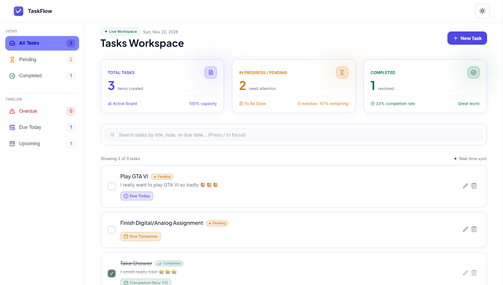
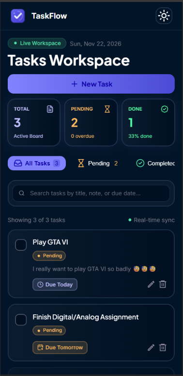
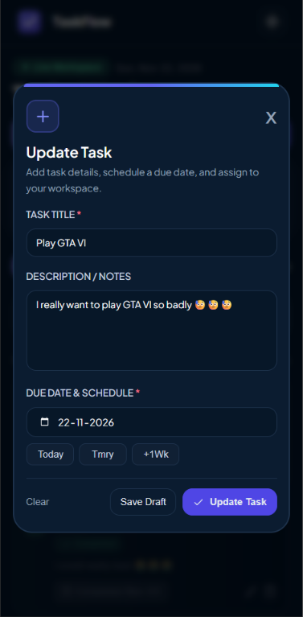

# ⚡ TASK FLOW

\<div align="center">

&#x20; \

&#x20; \<br/>

**A modern task management experience built for productivity.**

Organize your workflow, track deadlines, and take control of your day with a sleek and responsive To-Do application powered by React.

&#x20; \<br/>


\


&#x20; \<br/>

\<a href="#-preview">PREVIEW\</a> •
\<a href="#-features">FEATURES\</a> •
\<a href="#-tech-stack">TECH STACK\</a> •
\<a href="#-installation">INSTALLATION\</a>

\</div>

---

## ◈ PREVIEW

\<div align="center">

&#x20; \
&#x20; \

\<br/>\<br/>

&#x20; \
&#x20; \
&#x20; \

\</div>

---

## ◈ FEATURES

> **Everything you need to stay organized and productive.**

| Feature                   | Description                                                     |
| :------------------------ | :-------------------------------------------------------------- |
| ⚡ **Task Management**     | Create, edit, and delete tasks effortlessly.                    |
| 📝 **Task Description**   | Add detailed descriptions for better context.                   |
| 📅 **Due Dates**          | Assign deadlines and manage your schedule.                      |
| ✅ **Task Status**         | Track completed and pending tasks.                              |
| 🎯 **Smart Filtering**    | Filter tasks according to their status and deadlines.           |
| ⏰ **Due Date Tracking**   | Identify overdue, due today, and upcoming tasks.                |
| 🧭 **Sidebar Navigation** | Navigate between different task categories.                     |
| 📱 **Responsive Design**  | Seamless experience across desktop, tablet, and mobile devices. |
| 🌗 **Theme Switching**    | Instantly switch between Light and Dark themes.                 |

---

## ◈ TECH STACK

**Built using modern web technologies.**

\<div align="center">

|      Technology     | Purpose                             |
| :-----------------: | :---------------------------------- |
|     ⚛️ **React**    | Component-based UI development      |
|  🟨 **JavaScript**  | Application logic and functionality |
|      🎨 **CSS**     | Styling and responsive layouts      |
|      ⚡ **Vite**     | Development server and build tool   |
| 🧩 **Lucide React** | Icons and visual elements           |

\</div>

---

## ◈ INSTALLATION

**Get the project running on your local machine.**

### 01 — Prerequisites

Make sure you have the following installed:

- [Node.js](https://nodejs.org/)
- npm (included with Node.js)

### 02 — Clone the repository

```bash
git clone https://github.com/DeveloperR0nit/ToDo-List
```

### 03 — Navigate to the project

```bash
cd to-do-list
```

### 04 — Install dependencies

```bash
npm install
```

### 05 — Launch the development server

```bash
npm run dev
```

Open the local URL provided by Vite in your browser.

---

## ◈ PROJECT STRUCTURE

```text
TASK-MANAGER/
│
├── public/
├── screenshots/
│
├── src/
│   ├── components/
│   ├── context/
│   ├── hooks/
│   ├── utils/
│   ├── App.jsx
│   ├── main.jsx
│   └── index.css
│
├── package.json
├── vite.config.js
└── README.md
```

---

## ◈ AVAILABLE SCRIPTS

| Command           | Description                          |
| :---------------- | :----------------------------------- |
| `npm run dev`     | Start the development server         |
| `npm run build`   | Build the application for production |
| `npm run preview` | Preview the production build         |
| `npm run lint`    | Run ESLint                           |

---

## ◈ FUTURE UPGRADES

The mission isn't over yet. Here's what's planned:

- [ ] 💾 Database integration for persistent tasks and cross-platform sync.
- [ ] 🚩 Task priority levels.
- [ ] 🔃 Advanced task sorting and filtering.
- [ ] ⏰ Task due time and alerts.

---

\<div align="center">

## ⚡ PRODUCTIVITY MODE: ACTIVATED

**PLAN SMARTER. WORK BETTER. GET THINGS DONE.**

&#x20; \<br/>

Built with ❤️ using **React + Vite**

&#x20; \

\<br/>\<br/>

*Thanks for checking out this project!*

\</div>
